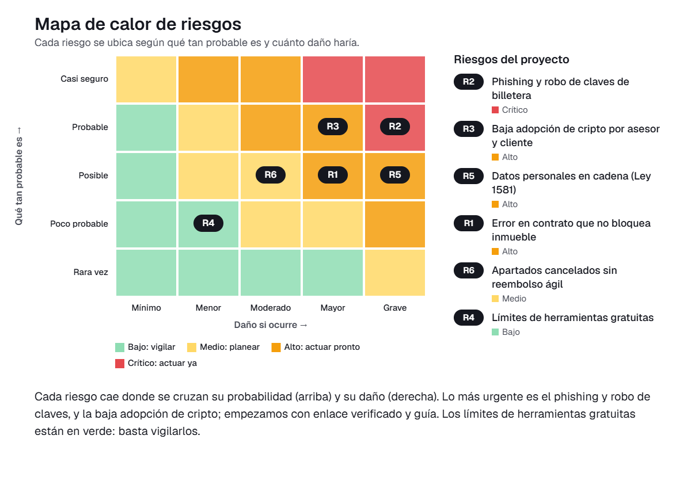

# 09 · Gestión de riesgos

En este documento presentamos la matriz de riesgos de implementar en Abitare la solución de pago del apartado de inmuebles con criptomonedas. La solución se compone de una página web, una billetera digital tipo MetaMask y un contrato inteligente en red de prueba. Para valorar los riesgos tuvimos en cuenta que la solución maneja datos de usuario y medios de pago en criptomonedas. También que la usarán a diario el cliente y la empresa, y que el presupuesto del proyecto es de cero pesos, por lo que trabajamos solo con herramientas gratuitas.

Calculamos el nivel de cada riesgo como **probabilidad (1-5) × impacto (1-5)**. Lo clasificamos así: 1-4 bajo, 5-9 medio, 10-16 alto y 20-25 crítico.

## Matriz de riesgos

| ID | Riesgo | Categoría | P | I | Nivel | Tratamiento | Acción | Responsable | Fecha |
|---|---|---|---|---|---|---|---|---|---|
| R1 | Error en el contrato que no bloquea el inmueble | Tecnológico | 3 | 4 | 12 · Alto | Mitigar | Probar el contrato en Sepolia con casos de pago duplicado, monto incorrecto y pago sobre un inmueble ya bloqueado. Otro integrante revisa el código antes de la demostración. | PR | 10 de noviembre |
| R2 | Phishing y robo de claves de la billetera | Datos y ciberseguridad | 4 | 5 | 20 · Crítico | Mitigar | Publicar la página en un único dominio gratuito con HTTPS. Mostrar la dirección del contrato para que el cliente la verifique. Dejar claro en la página y en la guía que nunca se piden frases semilla ni claves. | AP | 12 de noviembre |
| R3 | Baja adopción de cripto por asesor y cliente | Personas y adopción | 4 | 4 | 16 · Alto | Mitigar | Elaborar una guía ilustrada de una página para instalar MetaMask y pagar en red de prueba. Hacer una prueba guiada con el asesor y simplificar los textos de la pantalla según lo que observemos. | UX | 13 de noviembre |
| R4 | Límites de herramientas gratuitas | Financiero | 2 | 2 | 4 · Bajo | Aceptar | Usar solo servicios gratuitos y red de prueba, sin fondos reales. Revisar el consumo de los planes gratuitos antes de la presentación. | LP | 7 de noviembre |
| R5 | Datos personales en cadena (Ley 1581) | Legal | 3 | 5 | 15 · Alto | Evitar | No registrar datos personales en el contrato. Guardar en cadena solo el identificador del inmueble, el monto, la fecha y el hash. Incluir un aviso de tratamiento de datos con autorización previa en la pantalla de registro. | LP | 11 de noviembre |
| R6 | Apartados cancelados sin reembolso ágil | Operativo | 3 | 3 | 9 · Medio | Mitigar | Definir con el asesor un procedimiento de cancelación. El apartado se devuelve desde la billetera de la empresa y el inmueble se libera mediante una función del contrato solo para el administrador. | AP | 14 de noviembre |

## Riesgos altos y críticos: plan de respuesta

### R2 · Phishing y robo de claves de la billetera (crítico, 20)
Es el riesgo más urgente. El cliente paga desde su propia billetera y podría caer en un enlace falso que imite la página de reserva de Abitare. Un fraude de este tipo dañaría la confianza en la inmobiliaria y en el proceso. Nuestro plan es publicar un único dominio oficial con HTTPS y que el asesor comparta el enlace solo por el canal acordado. En la página se muestra la dirección del contrato para que el cliente la contraste. La guía de uso advierte que ni el equipo ni Abitare piden frases semilla ni claves privadas. Durante el proyecto trabajamos solo en red de prueba, por lo que no hay fondos reales expuestos.

### R3 · Baja adopción de cripto por asesor y cliente (alto, 16)
La solución funciona solo si el asesor y el cliente se sienten cómodos con una billetera digital. Si el proceso les resulta confuso, volverán a la transferencia bancaria y al comprobante por WhatsApp. Por eso preparamos una guía ilustrada de una página y hacemos una prueba guiada con el asesor sin darle ayuda durante el pago. Con lo que observemos, ajustamos los textos y los pasos de la pantalla hasta que pueda completar el flujo por sí solo, que es el criterio de éxito de nuestra hipótesis.

### R5 · Datos personales en cadena (Ley 1581) (alto, 15)
La Ley 1581 de 2012 exige autorización del titular, finalidad clara y la posibilidad de actualizar o suprimir sus datos. Un registro en blockchain es público e inmutable, y por eso no permite suprimir datos. Evitamos el riesgo desde el diseño: el contrato guarda solo el identificador del inmueble, el monto, la fecha y el hash de la transacción. Los datos del cliente se manejan fuera de la cadena, con un aviso de tratamiento y autorización previa en la pantalla de registro del apartado.

### R1 · Error en el contrato que no bloquea el inmueble (alto, 12)
El contrato debe bloquear el inmueble en cuanto recibe el pago, porque ese es el problema central que queremos resolver. Un error de lógica permitiría apartar dos veces el mismo inmueble o aceptar montos incorrectos. Lo mitigamos con pruebas en Sepolia que cubren pago duplicado, monto incorrecto e intento de pago sobre un inmueble ya bloqueado. Además, otro integrante revisa el código antes de la demostración.

### Cómo leer el mapa de calor

Cada riesgo aparece en la casilla donde se cruzan dos cosas: qué tan probable es, de abajo hacia arriba, y cuánto daño haría, de izquierda a derecha. El color va del verde, donde se puede estar tranquilo, al rojo, donde hay que actuar ya. En nuestro proyecto lo más arriba y a la derecha quedó el *phishing y robo de claves de la billetera*, porque el cliente paga desde su propia billetera y un enlace falso dañaría la confianza en Abitare. Muy cerca están la *baja adopción de cripto por asesor y cliente*, que haría volver a los comprobantes por WhatsApp, y los *datos personales en cadena (Ley 1581)*, porque lo que se escribe en blockchain no se puede borrar. Por eso empezamos con el enlace oficial verificable, la guía ilustrada y un contrato que no guarda datos personales. El *error en el contrato que no bloquea el inmueble* queda en naranja y lo cubrimos con pruebas en Sepolia. En verde quedaron los *límites de herramientas gratuitas*, porque trabajamos en red de prueba sin fondos reales y basta con revisar el consumo antes de presentar. Los *apartados cancelados sin reembolso ágil* están en amarillo y los resolvemos con un procedimiento de cancelación acordado con el asesor.

## Conclusión

Los riesgos más graves de la solución están en la confianza del usuario (seguridad de la billetera y adopción) y en el manejo de datos personales, no en el costo. Atenderlos antes del 18 de noviembre con las acciones definidas deja el prototipo listo para una prueba segura y comprensible para el asesor de Abitare.

