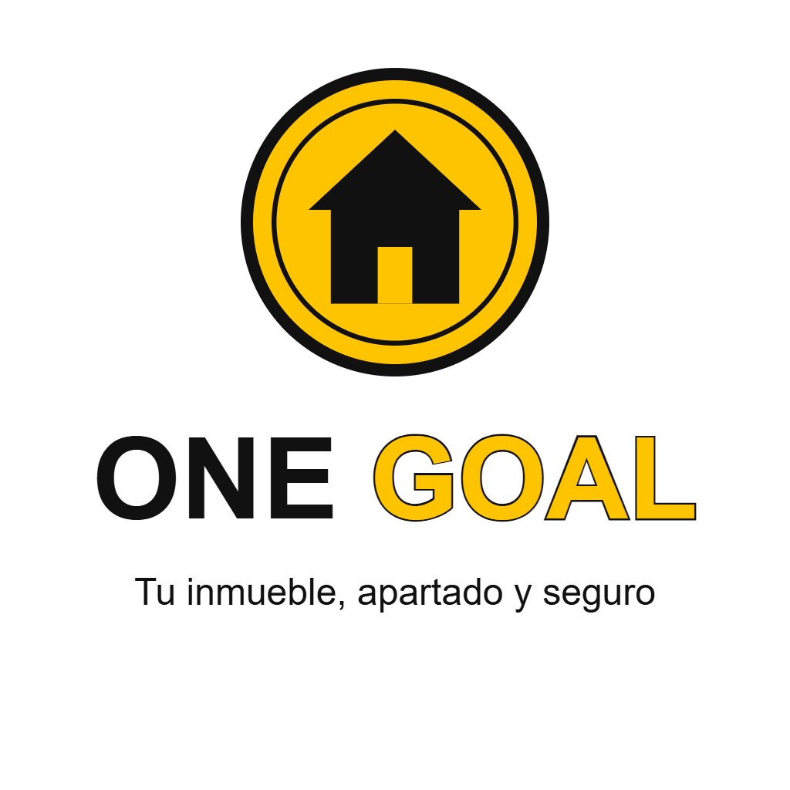

# 10 · Campaña de lanzamiento

## Introducción

Esta campaña presenta nuestra solución a los clientes de Abitare, que son quienes pagan el apartado de un inmueble. Queremos transmitir un tono **innovador y confiable**: una forma moderna de apartar un inmueble, con un pago claro, verificable y protegido.

## 1. Nombre de la solución

Evaluamos tres nombres de 1 a 5 (5 es la mejor valoración) según tres criterios: que sea corto, que sea recordable y que se asocie al beneficio de la solución.

| Nombre | Corto | Recordable | Asociado al beneficio | Total |
|---|---|---|---|---|
| **One Goal** | 5 | 5 | 5 | **15** |
| ApartaChain | 3 | 3 | 4 | 10 |
| SelloCasa | 4 | 3 | 3 | 10 |

**Nombre recomendado: One Goal.** Tiene dos palabras cortas y fáciles de recordar. Expresa una sola meta: que el cliente aparte su inmueble en un solo paso y con la certeza de que nadie más puede tomarlo. La palabra *goal* también remite a la idea de meta cumplida, que en este caso es el apartado confirmado.

## 2. Eslóganes

1. Una meta: tu inmueble apartado y seguro
2. Paga una vez, aparta con certeza
3. **Tu inmueble, apartado y seguro** ← *elegido*

Elegimos el tercero porque es breve, habla directamente al cliente y resume los dos beneficios principales: el inmueble queda apartado y el pago queda protegido.

## 3. Identidad visual

### Paleta de colores

| Color | HEX | Uso |
|---|---|---|
| Negro | `#111111` | Palabra "ONE", contornos y textos |
| Amarillo brillante | `#FFC400` | Palabra "GOAL" y fondo de la moneda |
| Dorado | `#C99700` | Detalles, bordes y acentos de la moneda |

### Tipografía

**Montserrat** (Google Fonts, licencia libre y gratuita), en peso Bold para el nombre y Regular para el eslogan.

## 4. Significado del logo

El logo es una moneda dorada con una casa en el centro. Representa el pago con criptomonedas y el inmueble que queda apartado y protegido.
El negro de "ONE" transmite solidez y confianza, y el amarillo dorado de "GOAL" transmite valor e innovación.

## 5. Stickers de lanzamiento

Para el lanzamiento entregaremos a los asistentes una hoja de **12 stickers de 5 × 5 cm**, organizados en 3 columnas por 4 filas. Cada sticker incluye:

- El logo de One Goal (moneda con casa).
- El nombre **One Goal**, con "ONE" en negro y "GOAL" en amarillo dorado.
- El eslogan **"Tu inmueble, apartado y seguro"**.
- Un código QR que lleva al prototipo: https://github.com/felipeesco/Grupo-1-One-goal/blob/main/docs/07-prototipos.md?plain=1

Con el sticker, el cliente se lleva la marca y puede abrir el prototipo desde su celular.

.pdf)

